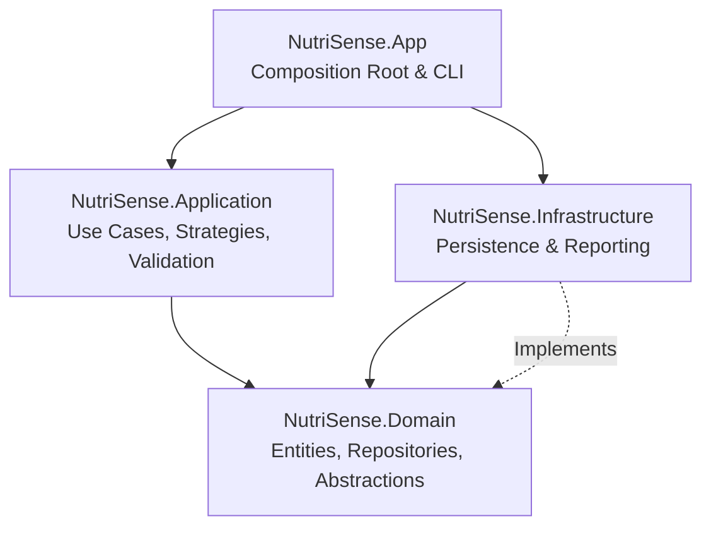
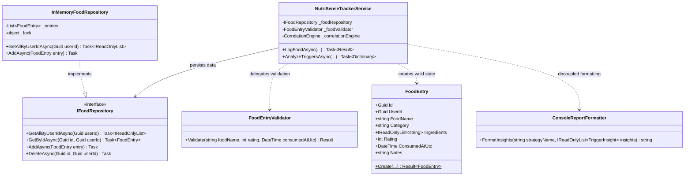
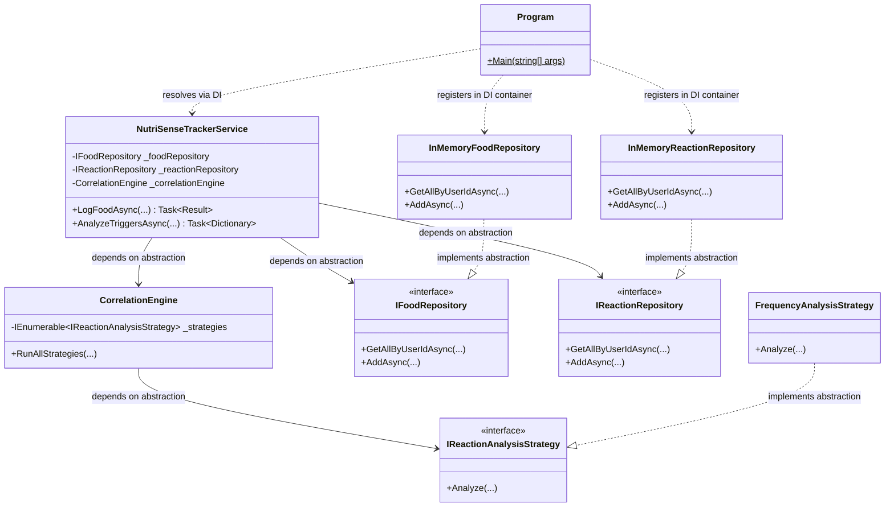

# NutriSense - Food & Reaction Intolerance Tracker: SOLID Principles Implementation

**Laboratory Work 1**

---

## Table of Contents

- [Introduction](#introduction)
- [System Architecture & Clean Design](#system-architecture--clean-design)
- [Features](#features)
- [SOLID Principles Applied](#solid-principles-applied)
  - [1. Single Responsibility Principle (SRP)](#1-single-responsibility-principle-srp)
    - [Concept & Architectural Rationale](#concept--architectural-rationale)
    - [Implementation in NutriSense](#implementation-in-nutrisense)
    - [UML Class Diagram (SRP)](#uml-class-diagram-srp)
    - [Code Implementation](#code-implementation)
  - [2. Open/Closed Principle (OCP)](#2-openclosed-principle-ocp)
    - [Concept & Architectural Rationale](#concept--architectural-rationale-1)
    - [Implementation in NutriSense](#implementation-in-nutrisense-1)
    - [UML Class Diagram (OCP)](#uml-class-diagram-ocp)
    - [Code Implementation](#code-implementation-1)
  - [3. Dependency Inversion Principle (DIP)](#3-dependency-inversion-principle-dip)
    - [Concept & Architectural Rationale](#concept--architectural-rationale-2)
    - [Implementation in NutriSense](#implementation-in-nutrisense-2)
    - [UML Class Diagram (DIP)](#uml-class-diagram-dip)
    - [Code Implementation](#code-implementation-2)
  - [Supporting Principles (LSP & ISP)](#supporting-principles-lsp--isp)
- [Project Structure](#project-structure)
  - [Directory Breakdown](#directory-breakdown)
- [Usage & Verification](#usage--verification)
  - [Running the Application](#running-the-application)
  - [Example Console Output](#example-console-output)
  - [Interactive HTML Visualizer](#interactive-html-visualizer)
- [Conclusion](#conclusion)
- [Author](#author)

---

## Introduction

Welcome to the **NutriSense (Food & Adverse Reaction Intolerance Tracker)** project, developed as part of **Laboratory Work 1** for the **TMPS** (*Techniques and Mechanisms of Software Design*) course.

Modern nutritional science and gastroenterology emphasize that adverse food reactions—such as acid reflux, migraines, skin breakouts, and gastrointestinal distress—are frequently delayed by several hours, making manual identification error-prone. **NutriSense** is an automated analytical platform engineered in **C# / .NET 10** designed to correlate meal ingestion events with delayed adverse physiological reactions across customizable time windows.

The primary objective of this laboratory work is to showcase the practical application of **SOLID** object-oriented design principles to engineer a modular, decoupled, and extensible enterprise-grade architecture. Rather than building a monolithic script, the system partitions responsibilities across Clean Architecture boundaries, implements pluggable statistical strategies, and decouples high-level business policies from low-level infrastructure details.

---

## System Architecture & Clean Design

The project is structured according to **Clean Architecture** patterns, divided into four distinct projects with strictly enforced dependency boundaries:



1. **`NutriSense.Domain`**: Core enterprise business models (`FoodEntry`, `ReactionEntry`, `TriggerInsight`), domain result wrappers (`Result<T>`, `Error`), and primary abstraction contracts (`IFoodRepository`, `IReactionRepository`, `IReactionAnalysisStrategy`). It has zero external dependencies.
2. **`NutriSense.Application`**: Encapsulates application-specific business logic, input validation rules (`FoodEntryValidator`, `ReactionEntryValidator`), analytical strategies (`FrequencyAnalysisStrategy`, `SeverityWeightedStrategy`, `IngredientIntoleranceStrategy`), and orchestrators (`CorrelationEngine`, `NutriSenseTrackerService`).
3. **`NutriSense.Infrastructure`**: Concrete adapters for persistence (`InMemoryFoodRepository`, `InMemoryReactionRepository`) and visualization presenters (`ConsoleReportFormatter`, `HtmlChartReportFormatter`).
4. **`NutriSense.App`**: The user-facing command-line interface (CLI) and composition root that configures the Microsoft Dependency Injection container (`IServiceCollection`).

---

## Features

- **Meal & Symptom Tracking**:
  - Detailed food logging capturing dish names, dietary categories, parsed ingredient lists, meal satisfaction ratings (1–5), and UTC timestamps.
  - Symptom tracking recording clinical manifestations (e.g., *Heartburn*, *Acne Flare-up*, *Migraine & Crash*), pain/distress severity scale (1–10), duration, and contextual clinical notes.
- **Multi-Strategy Adverse Reaction Correlation**:
  - **Frequency Correlation Strategy**: Identifies raw recurrence percentages of reactions occurring within a configurable postprandial window (e.g., 2–12 hours).
  - **Severity-Weighted Impact Strategy**: Calculates composite clinical risk indices by compounding recurrence likelihood with recorded symptom severity.
  - **Ingredient-Level Allergen Strategy**: Deconstructs complex dishes into constituent ingredients (e.g., *dairy*, *gluten*, *caffeine*, *spicy*) to detect latent cross-meal trigger intolerances.
- **Robust Domain Validation**: Strict boundary checks (forbidden future dates, length constraints, star ratings) isolated from data stores.
- **Dual Presentation Modes**:
  - Rich ANSI-styled terminal dashboards.
  - Interactive browser dashboard powered by Chart.js for data visualization.
- **Enterprise Extensibility**: Seamless addition of new correlation algorithms or persistent databases without refactoring core services.

---

## SOLID Principles Applied

The implementation specifically focuses on three core SOLID principles, with supporting integration of the remaining two:

1. **Single Responsibility Principle (SRP)**
2. **Open/Closed Principle (OCP)**
3. **Dependency Inversion Principle (DIP)**

---

### 1. Single Responsibility Principle (SRP)

> **Definition**: *A class should have one, and only one, reason to change.*

#### Concept & Architectural Rationale

In unprincipled designs, an entity often becomes a "God Object"—it holds domain data, parses user inputs, validates business constraints, communicates directly with a database, and generates formatted reports. Any change to UI layouts, database schemas, or validation thresholds causes ripple effects across the entire class.

In **NutriSense**, every class is restricted to a single axis of change:
- **`FoodEntry`**: Encapsulates internal domain state and invariant rules (`Create`, rating limits, UTC conversion).
- **`FoodEntryValidator`**: Solely responsible for verifying user input prior to entity creation (string lengths, range boundaries, future date prevention).
- **`InMemoryFoodRepository`**: Solely responsible for thread-safe storage, retrieval, and collection management. It knows nothing about correlation math or display formatting.
- **`CorrelationEngine`**: Solely responsible for coordinating and dispatching analysis requests across registered strategy algorithms.
- **`ConsoleReportFormatter` & `HtmlChartReportFormatter`**: Solely responsible for rendering presentation output (terminal tables and Chart.js dashboards). Modifying report styles never impacts domain logic or data storage.

#### UML Class Diagram (SRP)



#### Code Implementation

The separation between input verification and domain construction illustrates SRP:

```csharp
// 1. Validation Responsibility: Solely validates client input
public sealed class FoodEntryValidator
{
    public Result Validate(string? foodName, int rating, DateTime consumedAtUtc)
    {
        if (string.IsNullOrWhiteSpace(foodName))
            return Result.Failure(Error.Validation("FoodValidation.EmptyName", "Food item name is required."));

        if (foodName.Trim().Length is < 2 or > 100)
            return Result.Failure(Error.Validation("FoodValidation.InvalidLength", "Food name must be between 2 and 100 characters."));

        if (rating is < 1 or > 5)
            return Result.Failure(Error.Validation("FoodValidation.InvalidRating", "Rating must be between 1 and 5 stars."));

        if (consumedAtUtc > DateTime.UtcNow.AddMinutes(5))
            return Result.Failure(Error.Validation("FoodValidation.FutureDate", "Meal consumption time cannot be in the future."));

        return Result.Success();
    }
}

// 2. Domain State Responsibility: Solely manages entity creation and immutability
public sealed class FoodEntry
{
    public Guid Id { get; private set; }
    public Guid UserId { get; private set; }
    public string FoodName { get; private set; } = string.Empty;
    public string Category { get; private set; } = string.Empty;
    public IReadOnlyList<string> Ingredients { get; private set; } = [];
    public int Rating { get; private set; }
    public DateTime ConsumedAtUtc { get; private set; }
    public string Notes { get; private set; } = string.Empty;

    public static Result<FoodEntry> Create(
        Guid userId, string foodName, string category,
        IEnumerable<string>? ingredients, int rating, DateTime consumedAtUtc, string notes = "")
    {
        // Enforces core invariants
        var entry = new FoodEntry
        {
            Id = Guid.NewGuid(),
            UserId = userId,
            FoodName = foodName.Trim(),
            Category = string.IsNullOrWhiteSpace(category) ? "General" : category.Trim(),
            Ingredients = ingredients?.Select(i => i.Trim().ToLowerInvariant()).Where(i => !string.IsNullOrEmpty(i)).ToList() ?? [],
            Rating = rating,
            ConsumedAtUtc = consumedAtUtc.Kind == DateTimeKind.Utc ? consumedAtUtc : consumedAtUtc.ToUniversalTime(),
            Notes = notes?.Trim() ?? string.Empty
        };

        return Result.Success(entry);
    }
}
```

---

### 2. Open/Closed Principle (OCP)

> **Definition**: *Software entities (classes, modules, functions, etc.) should be open for extension, but closed for modification.*

#### Concept & Architectural Rationale

Whenever application requirements evolve—such as adding a new correlation formula, integrating machine learning, or calculating circadian rhythm effects—the system must accommodate these new capabilities without altering existing, verified classes.

In **NutriSense**, this is achieved through the **Strategy Pattern**. The correlation computation mechanism is abstracted behind the `IReactionAnalysisStrategy` interface. 

The orchestrator `CorrelationEngine` depends exclusively on the abstraction collection `IEnumerable<IReactionAnalysisStrategy>`. When a new analytical model is conceived (e.g., `AiPredictiveStrategy`), developers simply create a new class implementing the interface and register it in the dependency injection container. The `CorrelationEngine` will discover, execute, and present the new insights without modifying a single line of existing code.

#### UML Class Diagram (OCP)

```mermaid
classDiagram
    direction TB

    class CorrelationEngine {
        -IEnumerable~IReactionAnalysisStrategy~ _strategies
        +AvailableStrategies : IReadOnlyList~IReactionAnalysisStrategy~
        +RunAllStrategies(foods, reactions, timeWindow) Dictionary
        +RunStrategy(strategyName, foods, reactions, timeWindow) IReadOnlyList~TriggerInsight~
    }

    class IReactionAnalysisStrategy {
        <<interface>>
        +string StrategyName
        +string Description
        +Analyze(foods, reactions, timeWindow) IReadOnlyList~TriggerInsight~
    }

    class FrequencyAnalysisStrategy {
        +string StrategyName
        +string Description
        +Analyze(foods, reactions, timeWindow) IReadOnlyList~TriggerInsight~
    }

    class SeverityWeightedStrategy {
        +string StrategyName
        +string Description
        +Analyze(foods, reactions, timeWindow) IReadOnlyList~TriggerInsight~
    }

    class IngredientIntoleranceStrategy {
        +string StrategyName
        +string Description
        +Analyze(foods, reactions, timeWindow) IReadOnlyList~TriggerInsight~
    }

    class FutureAiClusteringStrategy {
        <<extension>>
        +string StrategyName
        +string Description
        +Analyze(foods, reactions, timeWindow) IReadOnlyList~TriggerInsight~
    }

    CorrelationEngine o-- IReactionAnalysisStrategy : consumes abstraction
    FrequencyAnalysisStrategy ..|> IReactionAnalysisStrategy : implements
    SeverityWeightedStrategy ..|> IReactionAnalysisStrategy : implements
    IngredientIntoleranceStrategy ..|> IReactionAnalysisStrategy : implements
    FutureAiClusteringStrategy ..|> IReactionAnalysisStrategy : extensible without modifying engine
```



#### Code Implementation

```csharp
// Strategy Abstraction: Open contract for any correlation algorithm
public interface IReactionAnalysisStrategy
{
    string StrategyName { get; }
    string Description { get; }

    IReadOnlyList<TriggerInsight> Analyze(
        IReadOnlyList<FoodEntry> foods,
        IReadOnlyList<ReactionEntry> reactions,
        TimeSpan timeWindow);
}

// Closed for modification: CorrelationEngine runs any strategy dynamically
public sealed class CorrelationEngine
{
    private readonly IEnumerable<IReactionAnalysisStrategy> _strategies;

    public CorrelationEngine(IEnumerable<IReactionAnalysisStrategy> strategies)
    {
        _strategies = strategies ?? throw new ArgumentNullException(nameof(strategies));
    }

    public Dictionary<string, IReadOnlyList<TriggerInsight>> RunAllStrategies(
        IReadOnlyList<FoodEntry> foods,
        IReadOnlyList<ReactionEntry> reactions,
        TimeSpan timeWindow)
    {
        var results = new Dictionary<string, IReadOnlyList<TriggerInsight>>();

        // Iterates through all registered strategies polymorphically
        foreach (var strategy in _strategies)
        {
            results[strategy.StrategyName] = strategy.Analyze(foods, reactions, timeWindow);
        }

        return results;
    }
}

// Concrete Extension: Severity-Weighted Strategy added without touching existing classes
public sealed class SeverityWeightedStrategy : IReactionAnalysisStrategy
{
    public string StrategyName => "Severity-Weighted Impact Analysis";
    public string Description => "Calculates an acute risk index by weighting symptom occurrences by recorded severity (1-10).";

    public IReadOnlyList<TriggerInsight> Analyze(
        IReadOnlyList<FoodEntry> foods,
        IReadOnlyList<ReactionEntry> reactions,
        TimeSpan timeWindow)
    {
        var insights = new List<TriggerInsight>();
        var foodsByName = foods.GroupBy(f => f.FoodName, StringComparer.OrdinalIgnoreCase);

        foreach (var foodGroup in foodsByName)
        {
            var symptomTypes = reactions.Select(r => r.SymptomType).Distinct(StringComparer.OrdinalIgnoreCase);
            foreach (var symptom in symptomTypes)
            {
                var correlatedSeverities = new List<int>();
                foreach (var meal in foodGroup)
                {
                    var matches = reactions.Where(r =>
                        string.Equals(r.SymptomType, symptom, StringComparison.OrdinalIgnoreCase) &&
                        r.OccurredAtUtc >= meal.ConsumedAtUtc &&
                        r.OccurredAtUtc <= meal.ConsumedAtUtc.Add(timeWindow));
                    correlatedSeverities.AddRange(matches.Select(m => m.Severity));
                }

                if (correlatedSeverities.Count > 0)
                {
                    var avgSeverity = correlatedSeverities.Average();
                    var correlationRate = (double)correlatedSeverities.Count / foodGroup.Count();
                    var compositeRiskScore = Math.Round(correlationRate * avgSeverity, 1);

                    insights.Add(new TriggerInsight(
                        foodGroup.Key,
                        symptom,
                        correlatedSeverities.Count,
                        foodGroup.Count(),
                        Math.Round(correlationRate * 100, 1),
                        compositeRiskScore,
                        compositeRiskScore >= 7.0 ? "Critical" : compositeRiskScore >= 4.5 ? "High" : "Moderate",
                        $"Urgent trigger suspect: avg severity {avgSeverity:F1}/10."));
                }
            }
        }

        return insights.OrderByDescending(i => i.RiskScore).ToList();
    }
}
```

---

### 3. Dependency Inversion Principle (DIP)

> **Definition**: *High-level modules should not depend on low-level modules. Both should depend on abstractions. Abstractions should not depend on details; details should depend on abstractions.*

#### Concept & Architectural Rationale

If the high-level business service `NutriSenseTrackerService` were to instantiate a concrete database repository (`new InMemoryFoodRepository()`), it would be tightly coupled to memory collections. Changing to an SQL database, testing with mocks, or replacing reporting formats would require modifying the core business logic.

Under DIP:
1. High-level application modules (`NutriSenseTrackerService`, `CorrelationEngine`) and low-level infrastructure modules (`InMemoryFoodRepository`, `InMemoryReactionRepository`) both depend strictly on domain contracts (`IFoodRepository`, `IReactionRepository`, `IReactionAnalysisStrategy`).
2. An IoC (Inversion of Control) container configured in `Program.cs` wires up concrete implementations to their respective abstractions at startup, ensuring complete runtime decoupling.

#### UML Class Diagram (DIP)



#### Code Implementation

High-level application service declaring constructor dependencies on abstractions:

```csharp
// High-Level Service: Relies exclusively on abstract interfaces and engine
public sealed class NutriSenseTrackerService
{
    private readonly IFoodRepository _foodRepository;
    private readonly IReactionRepository _reactionRepository;
    private readonly FoodEntryValidator _foodValidator;
    private readonly ReactionEntryValidator _reactionValidator;
    private readonly CorrelationEngine _correlationEngine;

    public NutriSenseTrackerService(
        IFoodRepository foodRepository,
        IReactionRepository reactionRepository,
        FoodEntryValidator foodValidator,
        ReactionEntryValidator reactionValidator,
        CorrelationEngine correlationEngine)
    {
        _foodRepository = foodRepository ?? throw new ArgumentNullException(nameof(foodRepository));
        _reactionRepository = reactionRepository ?? throw new ArgumentNullException(nameof(reactionRepository));
        _foodValidator = foodValidator ?? throw new ArgumentNullException(nameof(foodValidator));
        _reactionValidator = reactionValidator ?? throw new ArgumentNullException(nameof(reactionValidator));
        _correlationEngine = correlationEngine ?? throw new ArgumentNullException(nameof(correlationEngine));
    }

    public async Task<Result<Guid>> LogFoodAsync(...)
    {
        // Coordinates validation, entity creation, and repository persistence via abstractions
        ...
    }
}
```

Composition Root in `Program.cs` configuring Inversion of Control via Microsoft DI:

```csharp
// Program.cs: Composition Root resolving abstractions to concrete implementations
var services = new ServiceCollection();
var defaultUserId = Guid.Parse("11111111-1111-1111-1111-111111111111");

// Low-level persistence implementations registered as domain abstractions
services.AddSingleton<IFoodRepository>(_ => new InMemoryFoodRepository(defaultUserId));
services.AddSingleton<IReactionRepository>(_ => new InMemoryReactionRepository(defaultUserId));

// Validators & Domain Strategies registered polymorphically
services.AddSingleton<FoodEntryValidator>();
services.AddSingleton<ReactionEntryValidator>();
services.AddSingleton<IReactionAnalysisStrategy, FrequencyAnalysisStrategy>();
services.AddSingleton<IReactionAnalysisStrategy, SeverityWeightedStrategy>();
services.AddSingleton<IReactionAnalysisStrategy, IngredientIntoleranceStrategy>();

// High-level services wired with injected abstractions
services.AddSingleton<CorrelationEngine>();
services.AddSingleton<NutriSenseTrackerService>();
services.AddSingleton<ConsoleReportFormatter>();
services.AddSingleton<HtmlChartReportFormatter>();

var provider = services.BuildServiceProvider();
var tracker = provider.GetRequiredService<NutriSenseTrackerService>();
```

---

### Supporting Principles (LSP & ISP)

In addition to the three core principles, NutriSense incorporates **LSP** and **ISP**:

- **Liskov Substitution Principle (LSP)**: Every implementation of `IReactionAnalysisStrategy` (`FrequencyAnalysisStrategy`, `SeverityWeightedStrategy`, `IngredientIntoleranceStrategy`) can be substituted interchangeably into `CorrelationEngine` without violating behavioral invariants, mutating input collections, or throwing unexpected exceptions.
- **Interface Segregation Principle (ISP)**: Instead of creating a bloated, monolithic `ITrackerDatabase` interface containing dozens of mixed methods, repositories and formatters are segregated into dedicated, focused contracts: `IFoodRepository`, `IReactionRepository`, and `IReportFormatter`.

---

## Project Structure

### Directory Breakdown

```text
NutriSense/
├── NutriSense.Domain/                     # Pure Enterprise Domain Layer (Zero Dependencies)
│   ├── Common/
│   │   ├── Error.cs                       # Domain error model with validation tags
│   │   └── Result.cs                      # Functional Result pattern (Success/Failure)
│   ├── Entities/
│   │   ├── FoodEntry.cs                   # Meal log domain entity (SRP)
│   │   ├── ReactionEntry.cs               # Symptom occurrence domain entity (SRP)
│   │   └── TriggerInsight.cs              # Calculated statistical correlation record
│   ├── Repositories/
│   │   ├── IFoodRepository.cs             # Food storage contract (ISP, DIP)
│   │   └── IReactionRepository.cs         # Symptom storage contract (ISP, DIP)
│   ├── Strategies/
│   │   └── IReactionAnalysisStrategy.cs   # Pluggable correlation strategy contract (OCP)
│   └── NutriSense.Domain.csproj
│
├── NutriSense.Application/                # Core Business Logic & Orchestration Layer
│   ├── Services/
│   │   ├── CorrelationEngine.cs           # Strategy dispatcher (OCP, DIP)
│   │   └── NutriSenseTrackerService.cs    # Primary application facade (DIP)
│   ├── Strategies/
│   │   ├── FrequencyAnalysisStrategy.cs   # Recurrence rate algorithm (OCP, LSP)
│   │   ├── IngredientIntoleranceStrategy.cs# Cross-meal ingredient deconstruction (OCP, LSP)
│   │   └── SeverityWeightedStrategy.cs    # Weighted risk scoring algorithm (OCP, LSP)
│   ├── Validation/
│   │   ├── FoodEntryValidator.cs          # Input validation rules (SRP)
│   │   └── ReactionEntryValidator.cs      # Symptom validation rules (SRP)
│   └── NutriSense.Application.csproj
│
├── NutriSense.Infrastructure/             # Persistence Adapters & External Presenters
│   ├── Persistence/
│   │   ├── InMemoryFoodRepository.cs      # Thread-safe in-memory store with seeded data (SRP, DIP)
│   │   └── InMemoryReactionRepository.cs  # Symptom in-memory store with sample records (SRP, DIP)
│   ├── Reporting/
│   │   ├── ConsoleReportFormatter.cs      # Terminal tabular formatter (SRP)
│   │   ├── HtmlChartReportFormatter.cs    # Interactive HTML + Chart.js dashboard generator (SRP)
│   │   └── IReportFormatter.cs            # Formatter contract (ISP)
│   └── NutriSense.Infrastructure.csproj
│
├── NutriSense.App/                        # Presentation & Composition Root
│   ├── Program.cs                         # IoC setup, DI registration, Interactive Menu (DIP)
│   └── NutriSense.App.csproj
│
├── nutrisense_dashboard.html              # Generated interactive graphical dashboard
├── NutriSense.slnx                        # Modern .NET solution file
├── SOLID_DEFENCE.md                       # Comprehensive mentor defense cheat sheet
└── report.md                              # Formal Laboratory Work Report
```

---

## Usage & Verification

### Running the Application

Ensure the .NET 10 SDK is installed on your machine. From the root directory:

```bash
dotnet run --project NutriSense.App
```

### Example Console Output

When selecting **Option 2** (*Run All Correlation Strategies*), the engine executes all registered strategies over the seeded patient history:

```text
╔══════════════════════════════════════════════════════════════════════════════╗
║               NUTRISENSE • FOOD & REACTION INTOLERANCE TRACKER               ║
╚══════════════════════════════════════════════════════════════════════════════╝
 Automated pattern recognition and trigger correlation analysis for diet tracking.

[ MAIN MENU - NUTRISENSE ]
 1. View Meal Log & Adverse Reaction History
 2. Run All Correlation Strategies
 3. Log a New Meal & Adverse Reaction
 4. Generate & Open Web Dashboard with Interactive Charts
 0. Exit

Select an option [0-4]: 2

Executing correlation analysis across time window (default: 8 hours)...

=== FREQUENCY CORRELATION ANALYSIS ===
-------------------------------------------------------------------------------------
FOOD / INGREDIENT            | CORRELATED SYMPTOM       | RATE     | RISK     | LEVEL     
-------------------------------------------------------------------------------------
Spicy Thai Red Curry         | Heartburn / Acid Reflux  | 100%     | 10.0/10  | Critical  
  ↳ Recommendation: Strong intolerance suspect. Consider an elimination trial of 'Spicy Thai Red Curry' for 14 days.
Spicy Thai Red Curry         | Migraine & Crash         | 100%     | 10.0/10  | Critical  
  ↳ Recommendation: Strong intolerance suspect. Consider an elimination trial of 'Spicy Thai Red Curry' for 14 days.
Monster Energy Drink         | Migraine & Crash         | 100%     | 10.0/10  | Critical  
  ↳ Recommendation: Strong intolerance suspect. Consider an elimination trial of 'Monster Energy Drink' for 14 days.
Spicy Buffalo Wings          | Heartburn / Acid Reflux  | 100%     | 10.0/10  | Critical  
  ↳ Recommendation: Strong intolerance suspect. Consider an elimination trial of 'Spicy Buffalo Wings' for 14 days.
Spicy Jalapeno Burger        | Heartburn / Acid Reflux  | 100%     | 10.0/10  | Critical  
  ↳ Recommendation: Strong intolerance suspect. Consider an elimination trial of 'Spicy Jalapeno Burger' for 14 days.
Extra Cheese Pepperoni Pizza | Acne Flare-up            | 50%      | 5.0/10   | High      
  ↳ Recommendation: Mild correlation detected with 'Acne Flare-up'. Monitor further consumption.
-------------------------------------------------------------------------------------

=== SEVERITY-WEIGHTED IMPACT ANALYSIS ===
-------------------------------------------------------------------------------------
FOOD / INGREDIENT            | CORRELATED SYMPTOM       | RATE     | RISK     | LEVEL     
-------------------------------------------------------------------------------------
Spicy Thai Red Curry         | Heartburn / Acid Reflux  | 100%     | 9.0/10   | Critical  
  ↳ Recommendation: URGENT TRIGGER: Triggers severe Heartburn / Acid Reflux (Avg severity 9.0/10). Immediate elimination recommended.
Espresso Double Shot         | Heartburn / Acid Reflux  | 100%     | 8.5/10   | Critical  
  ↳ Recommendation: URGENT TRIGGER: Triggers severe Heartburn / Acid Reflux (Avg severity 8.5/10). Immediate elimination recommended.
Monster Energy Drink         | Migraine & Crash         | 100%     | 7.0/10   | Critical  
  ↳ Recommendation: URGENT TRIGGER: Triggers severe Migraine & Crash (Avg severity 7.0/10). Immediate elimination recommended.
Extra Cheese Pepperoni Pizza | Acne Flare-up            | 50%      | 3.5/10   | Moderate  
  ↳ Recommendation: Moderate trigger: Triggers Acne Flare-up with avg severity 7.0/10.
-------------------------------------------------------------------------------------

=== INGREDIENT-LEVEL ALLERGEN ANALYSIS ===
-------------------------------------------------------------------------------------
FOOD / INGREDIENT            | CORRELATED SYMPTOM       | RATE     | RISK     | LEVEL     
-------------------------------------------------------------------------------------
[Ingredient] HIGH-SUGAR      | Migraine & Crash         | 100%     | 10.0/10  | Critical  
  ↳ Recommendation: Found in 2 meals. Triggers Migraine & Crash 100% of the time. High probability of systemic sensitivity.
[Ingredient] SPICY           | Heartburn / Acid Reflux  | 100%     | 10.0/10  | Critical  
  ↳ Recommendation: Found in 3 meals. Triggers Heartburn / Acid Reflux 100% of the time. High probability of systemic sensitivity.
[Ingredient] COFFEE          | Heartburn / Acid Reflux  | 100%     | 10.0/10  | Critical  
  ↳ Recommendation: Found in 2 meals. Triggers Heartburn / Acid Reflux 100% of the time. High probability of systemic sensitivity.
[Ingredient] CHICKEN         | Heartburn / Acid Reflux  | 67%      | 6.7/10   | High      
  ↳ Recommendation: Found in 3 meals. Triggers Heartburn / Acid Reflux 66.7% of the time. High probability of systemic sensitivity.
[Ingredient] DAIRY           | Acne Flare-up            | 14%      | 1.4/10   | Moderate  
  ↳ Recommendation: Found in 7 meals. Triggers Acne Flare-up 14.3% of the time. High probability of systemic sensitivity.
-------------------------------------------------------------------------------------
```

### Interactive HTML Visualizer

Selecting **Option 4** runs `HtmlChartReportFormatter`, compiling patient records and trigger correlations into a standalone `nutrisense_dashboard.html` file and launching it directly into the default web browser. It displays dynamic bar charts, pie distributions, and timeline plots rendered with Chart.js.

---

## Conclusion

The **NutriSense** application demonstrates how SOLID principles turn a potentially tangled analytical program into an adaptable, clean, and maintainable software architecture:

1. **SRP (Single Responsibility Principle)** guarantees that classes do not accumulate unrelated duties. Data validation, domain state enforcement, persistence queries, correlation calculations, and user presentations each reside in distinct classes. Modifying a presentation layout or SQL schema has zero risk of corrupting analytical calculations.
2. **OCP (Open/Closed Principle)** establishes an extensible strategy infrastructure. New analytical algorithms (e.g., machine learning models, circadian rhythm trackers) can be introduced by simply implementing `IReactionAnalysisStrategy` without touching or risking regressions in `CorrelationEngine`.
3. **DIP (Dependency Inversion Principle)** decouples high-level business policies from low-level infrastructure details. `NutriSenseTrackerService` depends on interfaces (`IFoodRepository`, `IReactionRepository`, `IReactionAnalysisStrategy`), allowing low-level storage engines to be swapped or mocked for testing with zero changes to core application logic.
4. **LSP & ISP** provide supporting contract fidelity and modularity, ensuring that all strategies remain substitutable and clients only consume lean, targeted interface definitions.

Adherence to these principles yields an enterprise-grade codebase that is testable, decoupled, and prepared for future feature requirements.

---

## Author

- **Vitalie Vasilean**
- **Laboratory Work 1** – *Techniques and Mechanisms of Software Design (TMPS)*
- Technical University of Moldova (UTM)
